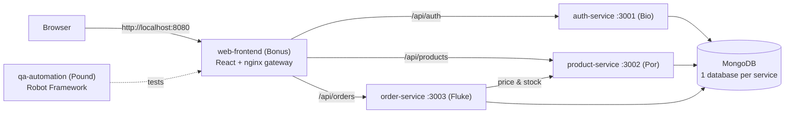

# 🛒 CampusMart — Software Deployment Final Project

A small campus shop built as **5 micro-service projects** with full CI/CD:
GitHub Actions → automated tests → Docker images released to **Docker Hub + GitHub Container Registry**.

| Folder (project) | Owner | Role | Tech | Read this |
|---|---|---|---|---|
| [`auth-service/`](auth-service/README.md) | **Bio** | PM + Developer | Node 24 · TypeScript · Express · MongoDB · JWT | [README](auth-service/README.md) |
| [`product-service/`](product-service/README.md) | **Por** | Developer | Node 24 · TypeScript · Express · MongoDB | [README](product-service/README.md) |
| [`order-service/`](order-service/README.md) | **Fluke** | Developer | Node 24 · TypeScript · Express · MongoDB | [README](order-service/README.md) |
| [`web-frontend/`](web-frontend/README.md) | **Bonus** | Developer | React · Vite · TypeScript · nginx (gateway) | [README](web-frontend/README.md) |
| [`qa-automation/`](qa-automation/README.md) | **Pound** | Tester | Robot Framework · RequestsLibrary · SeleniumLibrary | [README](qa-automation/README.md) |

Shared (PM-owned): [`docs/`](docs) · [`deploy/`](deploy) · [`docker-compose.yml`](docker-compose.yml) · [`.github/workflows/`](.github/workflows)

> Open **`campusmart.code-workspace`** in VS Code (File → Open Workspace from File) to see the 5 projects as 5 separate folders.

## Architecture



## Documents (PM deliverables)

| Document | What it is |
|---|---|
| [docs/API_CONTRACT.md](docs/API_CONTRACT.md) | **Read first.** Every endpoint, JSON shape, status code, JWT format, frontend element ids. All code must match it. |
| [docs/DEPLOYMENT_PLAN.md](docs/DEPLOYMENT_PLAN.md) | Environments, branching, versioning, deploy targets (compose, ngrok, K8s, Azure), verification, rollback |
| [docs/PIPELINE.md](docs/PIPELINE.md) | The automated CI/CD pipeline, every workflow, release how-to, grading evidence checklist |
| [docs/TEST_SPEC.md](docs/TEST_SPEC.md) | Test plan + 12 unit test specs + integration specs + 25 system/E2E test cases with traceability |
| [docs/TEAM_ROLES.md](docs/TEAM_ROLES.md) | Who does what, workload, what each person must explain |

---

## 1. Install once (everyone)

| Tool | Why | Check |
|---|---|---|
| [Git](https://git-scm.com/downloads) | version control | `git --version` |
| [Node.js 24 LTS](https://nodejs.org) | run/build services | `node -v` |
| [Docker Desktop](https://www.docker.com/products/docker-desktop/) (WSL2 on Windows) | run the whole system | `docker --version` |
| [VS Code](https://code.visualstudio.com/) | editor | |
| Python 3.12 (Pound, optional for others) | Robot Framework | `python --version` |

## 2. Get the code

```bash
git clone https://github.com/Boypemt/Cloud-deploy-final-project.git
cd Cloud-deploy-final-project
code campusmart.code-workspace
```

## 3. Run the whole system (5 services + MongoDB)

```bash
docker compose up -d --build     # first time takes a few minutes
docker compose ps                # every service should say (healthy)
```

| URL | What |
|---|---|
| http://localhost:8080 | the web app (through the nginx gateway) |
| http://localhost:8080/health/auth | auth-service health through the gateway |
| http://localhost:3001/health · :3002 · :3003 | each service directly |

```bash
docker compose logs -f order-service    # follow logs of one service
docker compose up -d --build auth-service   # rebuild only your service after changing it
docker compose down -v                  # stop everything and wipe the database
```

Run the automated tests against it (needs Python): see [qa-automation/README.md](qa-automation/README.md), or
`docker compose --profile test run --rm qa-automation`.

## 4. Work on your own project (developers)

```bash
docker compose up -d mongo              # only the database
cd product-service                      # your folder
cp .env.example .env                    # Windows PowerShell: copy .env.example .env
npm install
npm run dev                             # auto-restarts on save (nodemon)
npm test                                # unit tests
```
Details, your task list and an **AI prompt** for your part are in your folder's README.

## 5. Team Git workflow (everyone must follow)

```bash
git checkout main && git pull                       # always start from the newest main
git checkout -b feature/product-search              # one branch per task: feature/<service>-<thing>
# ...code + tests...
npm test                                            # must pass before pushing
git add .
git commit -m "product: add search by name (UT-PROD-02)"
git push -u origin feature/product-search
```
Then on GitHub: **Pull request → base: main**. CI must be green, Bio reviews and merges.

Rules:
1. **Only change files inside your own folder.** Need something in `docs/`, `docker-compose.yml`, `deploy/` or another service? Ask Bio / the owner.
2. **Never commit `.env`**, passwords, tokens or Atlas connection strings (`.gitignore` already blocks `.env`).
3. If your change needs the API contract to change → update `docs/API_CONTRACT.md` in the same PR and tell the team.
4. Small PRs, often. A red CI is fixed before anything else.
5. Bugs = GitHub Issues (`[TC-ID] short description`), see TEST_SPEC §7.

## 6. CI/CD in one picture

```
push / PR ─▶ CI - <your service>  : npm ci → build → unit tests → integration tests (MongoDB) → docker build
push main ─▶ E2E - Robot Framework: docker compose up (all 5) → Robot API + UI tests → report artifact
Release vX.Y.Z ─▶ Release         : all unit tests → build & push 5 images (Docker Hub + GHCR) → pull back & smoke test
```
Full explanation: [docs/PIPELINE.md](docs/PIPELINE.md).

## 7. Definition of Done (for every task)

- [ ] Matches `docs/API_CONTRACT.md` exactly (paths, JSON fields, status codes, element ids)
- [ ] Unit tests written for the task's logic and passing (`npm test`)
- [ ] `npm run build` has no TypeScript errors
- [ ] Works inside Docker: `docker compose up -d --build <service>` and health is `healthy`
- [ ] Pull request CI green, reviewed by Bio
- [ ] Pound told which test cases can drop the `wip` tag

## 8. Using AI (Claude / ChatGPT / Copilot) well

Each folder README ends with a ready-made prompt. For best results:
1. Open **your folder** as the working directory of your AI tool (e.g. `cd order-service && claude`).
2. Paste the prompt, plus the matching section of `docs/API_CONTRACT.md` if your AI can't read files.
3. Ask it to run `npm run build` and `npm test` and fix everything until green.
4. **Read and understand the code** before you commit — you must explain it in the presentation.
