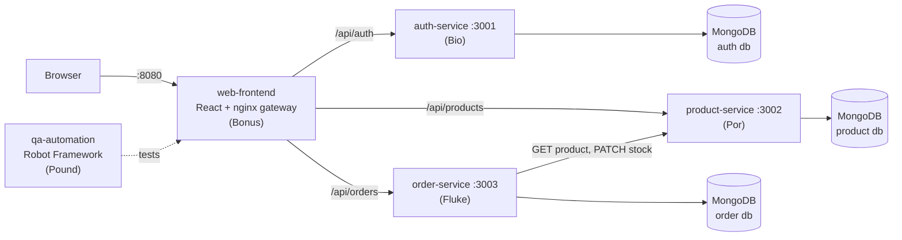

# CampusMart — Deployment Plan

| | |
|---|---|
| Owner | Bio (Project Manager) |
| Related | [PIPELINE.md](PIPELINE.md) (automation details) · [TEST_SPEC.md](TEST_SPEC.md) · [API_CONTRACT.md](API_CONTRACT.md) |

## 1. What we deploy

CampusMart is a small campus shop built as **5 independent projects** (micro-services). Each one has its own folder, its own `package.json`/`requirements.txt`, its own Dockerfile, its own CI workflow and its own image in the registry.



| Image (Docker Hub + GHCR) | Built from | Runs as |
|---|---|---|
| `campusmart-auth-service` | `auth-service/Dockerfile` (multi-stage Node 24) | API on 3001 |
| `campusmart-product-service` | `product-service/Dockerfile` | API on 3002 |
| `campusmart-order-service` | `order-service/Dockerfile` | API on 3003 |
| `campusmart-web-frontend` | `web-frontend/Dockerfile` (Vite build → nginx) | Web + gateway on 80 |
| `campusmart-qa-automation` | `qa-automation/Dockerfile` (Python + Chromium + Robot) | Test runner (job, not a server) |

**Database:** one MongoDB per environment, one *database name per service* (database-per-service pattern). Dev/CI use the `mongo:7` container; production uses **MongoDB Atlas** (as in the lecture — databases are not deployed as serverless containers).

## 2. Environments (Dev → Test → Staging → UAT → Production)

Same flow as the *Dev > Showcase < UAT* lecture.

| # | Environment | Where | Triggered by | Purpose |
|---|---|---|---|---|
| 1 | **Dev** | each member's laptop: `npm run dev` or `docker compose up` | developer | write code, run unit tests |
| 2 | **Test (CI)** | GitHub Actions runner | every `git push` / PR | build + unit + integration tests per service; Robot system tests on the full compose stack |
| 3 | **Staging (release check)** | GitHub Actions runner, images **pulled from Docker Hub** | GitHub Release published | prove the *published* images start and pass Smoke tests |
| 4 | **UAT / Showcase** | local stack + `ngrok http 8080`, or Kubernetes on Docker Desktop | PM before demo | friends / teacher try it (UAT checklist in TEST_SPEC §6) |
| 5 | **Production (cloud)** | Azure Container Apps (Azure for Students) + MongoDB Atlas | PM, manually, using a released tag | public URL |

## 3. Branching & versioning

- `main` is always releasable. Nobody pushes directly to `main` (branch protection: PR + green CI + 1 review).
- Work on branches: `feature/<service>-<thing>` (e.g. `feature/order-discount`), `fix/<issue>-<thing>`, `test/<thing>`, `docs/<thing>`.
- Each member only edits **their own folder** (prevents conflicts — same idea as the per-person `.gitignore` in the lecture). Shared files (`docker-compose.yml`, `docs/`, `.github/workflows/release.yml`, `deploy/`) are changed only by the PM or with the PM's approval.
- Versions follow **SemVer** `MAJOR.MINOR.PATCH`. A release = a GitHub Release with tag `vX.Y.Z`. All 5 images get the same version so we always know which set works together.

| Version | Meaning |
|---|---|
| `v0.1.0` | skeleton — all health checks green |
| `v0.5.0` | auth + products + login page working |
| `v1.0.0` | all features, all Critical tests pass — **submission** |
| `v1.0.x` | bug fixes after review |

## 4. Step-by-step: how a change reaches the registry

1. Developer creates a branch, writes code + unit tests, runs `npm test` locally.
2. `git push` → **CI - <service>** workflow: `npm ci → tsc build → unit tests (coverage) → integration tests with MongoDB → docker build`.
3. Open a Pull Request → CI runs again + **E2E - Robot Framework** runs the whole stack. PM reviews and merges.
4. When a milestone is ready, the PM creates a GitHub Release (`v1.0.0`) → **Release** workflow:
   1. *quality gate* – unit tests of all services again,
   2. *publish* – 5 images built and pushed to **Docker Hub** and **GitHub Container Registry** with tags `1.0.0`, `1.0`, `latest`, `sha-<commit>`; the version is baked in (`APP_VERSION`, shown on `/health`),
   3. *verify-release* – pulls the published images, starts them, checks `/health/auth` shows the version, runs Robot `Smoke` tests.
5. Optional continuous deployment to the cloud (section 6).

## 5. Secrets & configuration

| Secret | Where it lives | Used by |
|---|---|---|
| `DOCKER_USERNAME`, `DOCKER_PASSWORD` (Docker Hub access token) | GitHub → Settings → Secrets → Actions | release.yml |
| `GITHUB_TOKEN` | automatic | push to GHCR |
| `JWT_SECRET`, `INTERNAL_API_KEY` | `.env` (local, git-ignored), compose defaults (dev only), K8s Secret / Azure secrets (prod) | auth, product, order |
| `MONGO_URI` (Atlas) | `.env` / K8s Secret / Azure secret | auth, product, order |

Rules: `.env` files are git-ignored and docker-ignored; only `.env.example` is committed. Images contain no secrets — everything is passed as environment variables at run time.

## 6. Deploy targets

### 6.1 Local / demo — docker compose
```bash
docker compose up -d --build      # build from source
open http://localhost:8080
# or run the released images:
REGISTRY=docker.io/<dockerhub-user> TAG=1.0.0 docker compose -f deploy/docker-compose.release.yml up -d
```

### 6.2 Showcase — ngrok (lecture "4 for showcase")
```bash
docker compose up -d
ngrok http 8080          # share the https://xxxx.ngrok-free.app URL
```

### 6.3 Kubernetes (Docker Desktop) — see `deploy/k8s/README.md`
2 replicas per service, readiness/liveness probes on `/health`, ConfigMap + Secret, `LoadBalancer` service for the gateway. Demonstrates scaling, self-healing, rolling update and `kubectl rollout undo`.

### 6.4 Cloud — Azure Container Apps (Azure for Students, lecture part 4)
1. Create a *Container Apps environment* (one resource group `campusmart-rg`).
2. Create 3 internal apps from Docker Hub images: `auth-service` (port 3001), `product-service` (3002), `order-service` (3003) — **ingress: internal**, env vars from the table above (Atlas URIs as secrets).
3. Create `web-frontend` (port 80, **ingress: external**) with env `AUTH_SERVICE_URL=http://auth-service`, `PRODUCT_SERVICE_URL=http://product-service`, `ORDER_SERVICE_URL=http://order-service`.
4. In MongoDB Atlas → Network Access, allow `0.0.0.0/0` (class demo only).
5. Open the external URL → `/health/auth` must show the released version.

## 7. Post-deployment verification (every environment)
1. `GET /health` and `/health/auth|product|order` → 200 and `db: "up"`.
2. `version` on `/health/*` equals the release tag.
3. Run the smoke suite against it: `BASE_URL=<url> robot -d results -i Smoke qa-automation/tests` (or the `campusmart-qa-automation` image).
4. Manual: log in as `demo@campusmart.local`, place one order.

## 8. Rollback plan

| Problem | Action |
|---|---|
| Bad commit on `main` | `git revert <sha>` → push → CI (lecture part 2: `git revert HEAD`) |
| Bad release on Docker Hub | re-deploy the previous tag (`TAG=1.0.0`); images are immutable per version |
| Kubernetes | `kubectl rollout undo deployment/<service> -n campusmart` |
| Azure Container Apps | activate the previous revision |
| Database | Atlas daily snapshot restore (only if data was corrupted) |

## 9. Responsibilities (RACI-lite)

| Task | Bio (PM) | Por | Fluke | Bonus | Pound (Tester) |
|---|---|---|---|---|---|
| Deployment plan & pipeline docs | **R** | | | | C |
| Test spec | **R** | C | C | C | C |
| Release workflow, compose, k8s | **R** | | | | C |
| Service CI workflow | own service | own | own | own | e2e.yml |
| Unit + integration tests | auth | product | order | frontend | review |
| Robot automation | | | | | **R** |
| Release & smoke sign-off | **A** | | | | **R** |

R = does it · A = approves · C = consulted
