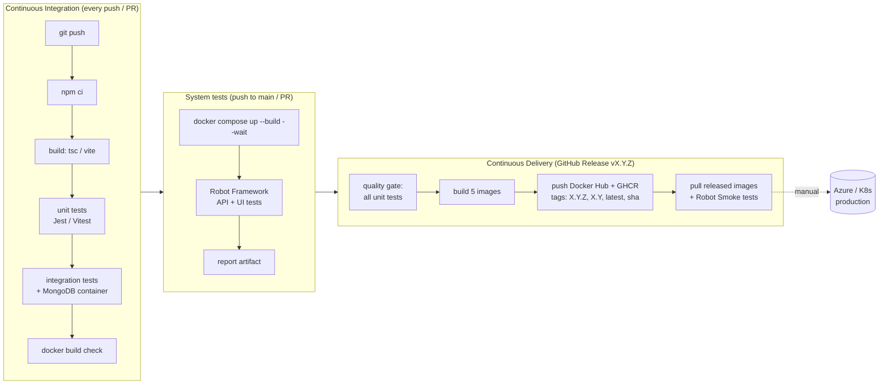

# CampusMart — Automated CI/CD Pipeline

| | |
|---|---|
| Owner | Bio (Project Manager) |
| Tool | GitHub Actions (remote repository: GitHub) |
| Registries | Docker Hub + GitHub Container Registry (ghcr.io) |

## 1. The big picture

This is **Continuous Delivery**: everything up to a verified image in the registry is automatic; promoting a version to the cloud is a deliberate (manual) step by the PM — exactly the difference between Continuous Delivery and Continuous Deployment from lecture part 4.

## 2. Workflows (all in `.github/workflows/`)

| File | Owner | Trigger | Jobs | Fails when |
|---|---|---|---|---|
| `ci-auth.yml` | Bio | push/PR touching `auth-service/**` | test (build, unit+coverage, integration with `mongo:7` service) → docker build | compile error, any test fails, Dockerfile broken |
| `ci-product.yml` | Por | `product-service/**` | same | same |
| `ci-order.yml` | Fluke | `order-service/**` | same | same |
| `ci-frontend.yml` | Bonus | `web-frontend/**` | type-check + Vite build, Vitest → docker build | same |
| `e2e.yml` | Pound | push to `main`, every PR, manual (optional tag filter) | compose up whole stack → Robot (excluding `wip`) → upload `robot-report` artifact (report.html, log.html, screenshots, container logs) | any ready Robot test fails / a container is unhealthy |
| `release.yml` | Bio | GitHub Release **published** (or manual with a version) | quality-gate (matrix 4 services) → publish (matrix 5 images) → verify-release (smoke on pulled images) | tests fail, push fails, released images fail smoke |

### Why path filters?
Each micro-service builds only when its own folder changes — a change in `order-service` never breaks or slows down Bonus's frontend pipeline. This keeps the 5 projects independent even though they live in one repository (mono-repo).

## 3. Pipeline stages explained (for the presentation)

1. **Checkout** – `actions/checkout` copies the repo onto an Ubuntu runner.
2. **Setup** – `actions/setup-node` (Node 24, npm cache) / `actions/setup-python` (3.12).
3. **Install** – `npm ci` installs exactly what is in `package-lock.json` (reproducible).
4. **Build** – `tsc` compiles TypeScript to `dist/` (type errors fail the build).
5. **Unit tests** – Jest/Vitest; a failing test returns a non-zero exit code → the job turns red (same idea as `process.exit(1)` in the class `Test1.ts` lab).
6. **Integration tests** – GitHub starts a `mongo:7` *service container*; tests talk to a real database through HTTP with Supertest.
7. **Docker build** – proves the Dockerfile still works before anyone merges.
8. **System/E2E tests** – the whole system starts with docker compose (5 services + MongoDB, health-checked), Robot Framework drives the API and a headless Chrome.
9. **Release** – `docker/metadata-action` turns the Git tag `v1.2.3` into image tags; `docker/build-push-action` pushes to both registries; `APP_VERSION` build-arg is baked in.
10. **Post-release verification** – the images are pulled back from Docker Hub and smoke-tested, so we know the *published artifact* works, not just the source.

## 4. One-time setup (PM)

1. Create the GitHub repo, push the project, add Por, Fluke, Bonus, Pound as **collaborators** (Settings → Collaborators).
2. Docker Hub → Account settings → **Personal access tokens** → new token (Read & Write).
3. GitHub → Settings → Secrets and variables → Actions → New repository secret:
   - `DOCKER_USERNAME` = Docker Hub username
   - `DOCKER_PASSWORD` = the token from step 2
4. GitHub → Settings → Actions → General → Workflow permissions → **Read and write** (lets `GITHUB_TOKEN` push to GHCR).
5. GitHub → Settings → Branches → add rule for `main`: require PR, require status checks (`Build & test`, `System tests on docker compose`).
6. After the first release: Docker Hub repos appear automatically (`<user>/campusmart-*`); on GitHub the packages appear under your profile → Packages (set visibility to public if the teacher needs to pull them).

## 5. How to make a release (PM)

1. Make sure `main` is green (all CI + E2E).
2. GitHub → Releases → **Draft a new release** → Choose tag → type `v1.0.0` → *Create new tag on publish* → title `v1.0.0` → **Generate release notes** → **Publish release**.
3. Watch **Actions → Release - publish Docker images**. All three jobs must be green.
4. Check Docker Hub: 5 repositories, each with tags `1.0.0`, `1.0`, `latest`, `sha-xxxxxxx`.
5. Download the `release-smoke-report` artifact and keep it for the presentation.

## 6. Evidence checklist for grading (screenshot each)

- [ ] Actions tab with green runs for all 6 workflows
- [ ] A **red** run caused by a failing unit test, then the green fix (shows the pipeline catches bugs)
- [ ] Robot `report.html` from the `robot-report` artifact
- [ ] Release page `v1.0.0`
- [ ] Docker Hub repositories with version tags
- [ ] GHCR packages
- [ ] Running system (compose / K8s / Azure) with `/health/auth` showing `"version": "v1.0.0"`
